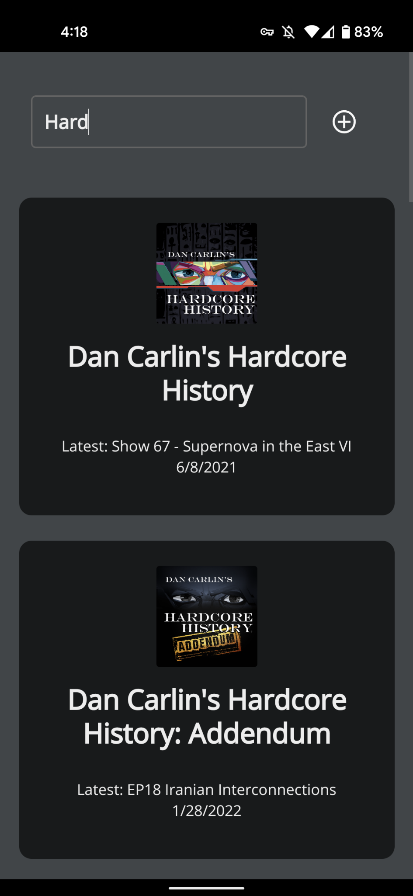
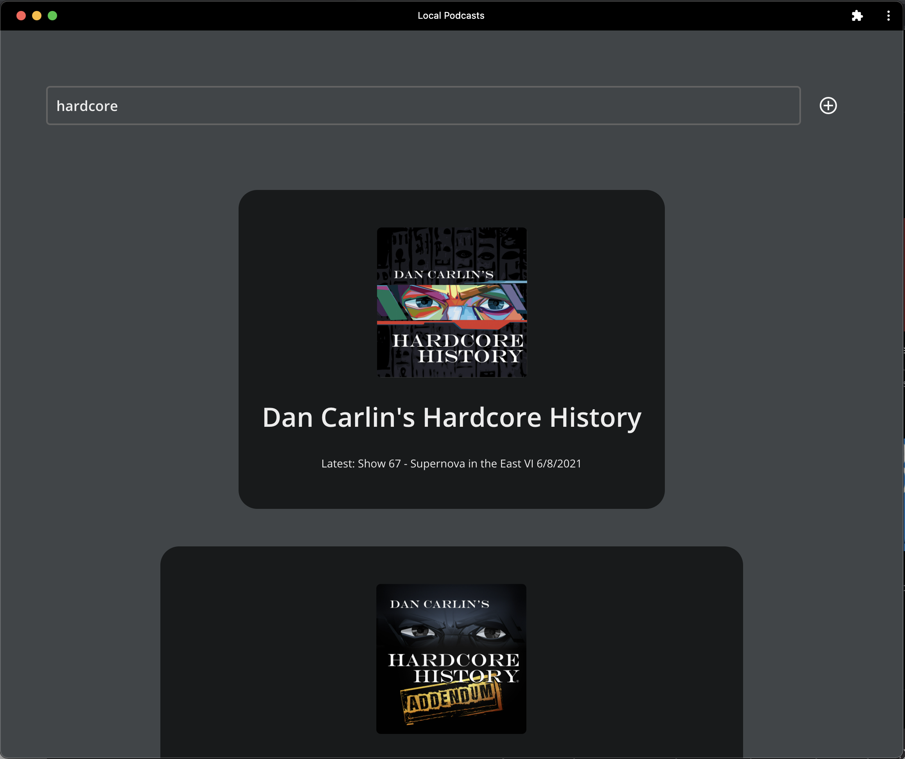

# Local Podcasts

A fully self hosted podcast manager.  Download & save the full history of a podcast on a local server for fast access & play with the Local Podcasts PWA.  This does not currently save podcasts to your device but only saves podcasts on the local server, so will not provide offline / remote access when not on your home network.

# Installation

## Docker
```bash
docker run -p 8080:8080 -v <path to podcast storage directory>:/data ghcr.io/nathanamorin/local-podcasts:<latest release tag here>
```

## Kubernetes
Modify the included Kuberntes manifests ```deployment/deployment.yaml``` to match your environment.
```bash
kubectl apply -f deployment/deployment.yaml
```

Mobile

Desktop


# API Documentation

An OpenAPI 3.0 spec is generated from Go handler annotations (via [swaggo/swag](https://github.com/swaggo/swag)) at build time and served at `/openapi.json`. A [Redoc](https://github.com/Redocly/redoc) UI for browsing it is available at `/doc` (alias: `/docs`), e.g. `http://localhost:8080/doc`. The Redoc UI bundle is vendored and embedded in the binary (`handlers/assets/redoc.standalone.js`), so the docs page has no external/CDN dependencies and works fully offline.

Prometheus metrics (including Go/process runtime metrics and a custom `local_podcasts_episode_downloads_total` counter, labeled by podcast and success/failure) are exposed at `/metrics`. In the deployed cluster this is scraped by a `ServiceMonitor` (see `deployment/deployment.yaml`).

Run `make generate-docs` to regenerate the spec locally before `go build`/`go test`, since the generated `apidocs/` package is not committed to version control.

`POST /podcasts` accepts either a direct RSS feed URL, or an Apple Podcasts show URL (e.g. `https://podcasts.apple.com/us/podcast/the-daily/id1200361736`), which is automatically resolved to its RSS feed via Apple's free iTunes Lookup API.

